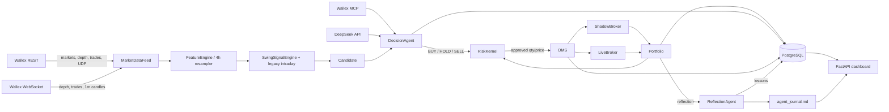

# Architecture

## Goals

ARGUS is designed around four properties:

1. **The AI has real authority, but bounded authority.** DeepSeek decides entries,
   size within a pre-approved range, order style, stop, take-profit and normal exits.
   A deterministic kernel can veto or force exits, and the AI can never raise a hard
   limit, use leverage, short, or withdraw.
2. **Every decision is reproducible.** Candidate features, prompt hashes, response
   hashes and risk checks are persisted. Backtests and AI ablation use the same code.
3. **Shadow and live share the same decision/risk/OMS path.** Only the broker differs.
4. **Failure is survivable.** Stale data, WebSocket loss, API errors, clock skew,
   reconciliation mismatch and drawdown all stop new risk; positions can be flattened.

## Component diagram

## Modes

| Mode | Broker | Data | Orders | Purpose |
|---|---|---|---|---|
| `backtest` | in-process simulator | Parquet UDF history | simulated | research, artifacts |
| `shadow` | `ShadowBroker` | live REST + WS | never sent | live rehearsal, learning |
| `live` | `LiveBroker` | live REST + WS | spot LIMIT orders | guarded challenge execution |
| `replay` | none | stored decisions/fills | none | audit and accounting check |

Mode YAML overlays live in `configs/`. Environment variables override YAML; the CLI
mode argument overrides `MODE` for that process. The live configuration is a canary:
250,000 TMN max order, 10% max position, 0.5% risk per trade.

## Startup sequence

1. Load settings, create directories, configure JSON logging.
2. Create the database engine and run/row.
3. Connect REST; fetch market metadata, depth for the allowlist, fees and balances.
4. Select the universe (metadata/volume/allowlist; data health is checked per order).
5. Seed 1m candles, 1h candles (for 4h resampling), depth and trades.
6. Start the WebSocket feed; on connect, resync REST snapshots.
7. Build the broker and portfolio (live restores global positions and TMN cash).
8. Initialize MCP, DeepSeek agent, memory, reflection and reconciler.
9. Check the kill file and startup invariants.
10. Start loops: decisions, positions, equity, reconciliation, maintenance, universe,
    regime memo, session review, heartbeat.

The API key is read with `python-dotenv`; keys containing `|` or `$` are safe. Do not
`source .env`.

## Loops and latency budget

| Loop | Period | Work |
|---|---:|---|
| position | 1s | marks, trailing stops, hard stops, time stops, OMS fills/timeouts |
| decision | 5s | regime, new signal-timeframe bar detection, candidate generation, AI, risk, entry |
| equity | 15s | portfolio snapshot, positions, drawdown/daily checks |
| reconciliation | 5s | live open orders and balances; shadow state |
| maintenance | 30s | stale book/trade refresh, health snapshots, market snapshots |
| universe | 1h | metadata/volume refresh, fee refresh, feed resubscribe |
| regime memo | 30m | DeepSeek or deterministic regime memo |
| session review | 15m check | DeepSeek reflection when trades occurred |
| heartbeat | 15s | container/dashboard health |

The AI call runs only when a new candidate appears. The position loop never awaits
the AI, so stops and fills are processed while a prompt is in flight. Swing signals
are only evaluated when a new completed signal-timeframe bar appears (`SWING_TIMEFRAME_HOURS`, default 4h).

## Market data

- REST snapshots: `/v1/depth`, `/v1/trades`, `/v1/udf/history`.
- WebSocket: Centrifugo v2, public channels, depth snapshots replace local sides,
  trades update the tape, 1m candles update the candle store.
- 1h candles are seeded for the slow strategy and resampled to completed 4h bars.
- The feed reconnects with exponential backoff. A reconnect triggers REST depth/trade
  resync. A WebSocket outage longer than 30s activates the kill switch; orders are
  cancelled and positions are flattened if configured.
- All candles are UTC. UDF 1m history is fetched in day-aligned UTC windows.

## Decision record

Each decision contains:

- deterministic candidate (signal, score, expected edge, costs, features),
- DeepSeek decision (action, confidence, size fraction, order style, stop/TP/horizon,
  rationale, flags, prompt/response hashes),
- risk checks and reasons,
- execution status, order IDs and fills.

The full prompt and raw response are stored in `llm_calls`. `agent_notes` stores
reflections. The dashboard and `decisions.jsonl` export are read-only.

## Execution

- All prices are quantized to the market tick; quantities are floored to the step.
- A client order ID is generated before sending and persisted before any network call.
- On an ambiguous POST timeout, the broker queries by client ID before treating the
  order as failed.
- Passive orders are cancelled/replaced up to three times after the timeout.
- Self-trade prevention blocks an opposite open order on the same symbol.
- Fees are in TMN. If the API reports a base-asset fee, it is converted at fill price.
- Live reconciliation compares open orders and balances; a mismatch halts the engine.

## Storage

Tables: `runs`, `market_snapshots`, `trades`, `features`, `decisions`, `orders`,
`fills`, `positions`, `equity`, `risk_events`, `llm_calls`, `agent_notes`,
`system_events`, `backtest_runs`, `shadow_runs`, `llm_cache`, `heartbeats`.

PostgreSQL is used in Docker. SQLite (WAL) is the local default for a zero-setup
development path. The schema is SQLAlchemy 2.0 async and portable.

## Artifacts

- `artifacts/backtests/<run_id>/`: report.html, metrics.json, equity.csv, trades.csv,
  decisions.jsonl, config.json, data_manifest.json, git_sha.txt, artifact_index.json.
- `artifacts/shadow/<run_id>/`: metrics.json, decisions.jsonl, agent_journal.md.
- `artifacts/ablations/`: AI cache and review JSON.
- `artifacts/parameter_study/`: study.json/md/html.
- `artifacts/replay/<run_id>/`: replay_report.json/md.
- `artifacts/preflight/`: timestamped preflight JSON.
- `artifacts/agent_journal.md`: append-only learning journal.
- `data/manifests/`: download manifest and gap report.

## Reproducibility

- Prompt version, model name, temperature, prompt hash and response hash are stored.
- The AI decision cache key includes the model, temperature, prompt version and full
  prompt payload.
- Backtest artifacts include the redacted config, data manifest and code SHA.
- `replay` reconstructs accounting from fills and verifies decision/order/fill linkage
  plus agent response hashes.
- `git_sha` falls back to `no-git` if the workspace is not a git repository.

## Known limitations

- Wallex does not provide historical L2 or trade tape; the backtest uses 1m OHLCV and
  a synthetic book with conservative spread/slippage. This is documented in the report.
- The 150-day sample is a strong crypto bull market. The strategy is trend-following
  and will lose in prolonged chop or a sustained bear market; de-risking and the kill
  switch are the protection.
- The 4h UDF resolution falls back to 1h on Wallex; the system therefore seeds 1h
  candles and resamples locally.
- The DeepSeek model can occasionally return empty content; the client retries with a
  larger token budget and lower reasoning effort, then HOLDs. This is logged.
