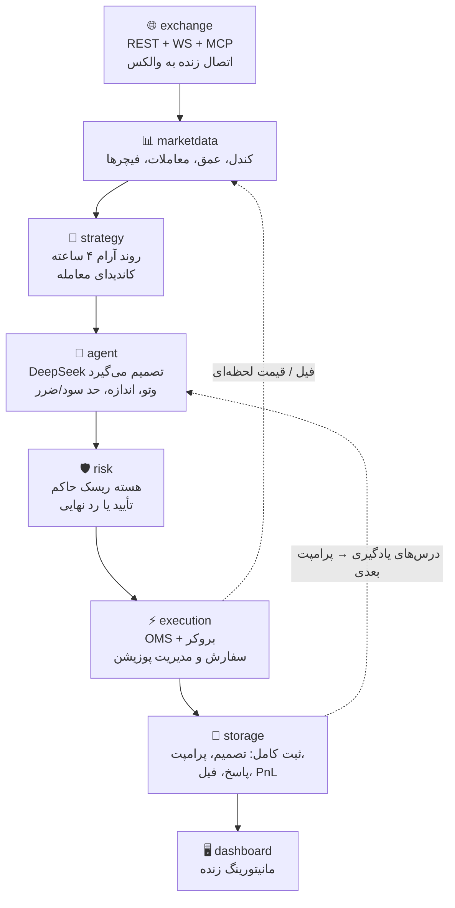

# 🎬 متن ویدیوی ۳ دقیقه‌ای — نسخه داوران (با نمودار چرخه و جزئیات AI)

*منطق چیدمان: مستقیم به جدول امتیازات مسابقه — سود و کنترل ضرر (۱۲۰)، منطق استراتژی (۴۰)، AI واقعی (۳۵)، ریسک (۳۰)، بازتولیدپذیری (۲۵)، بک‌تست و شادو (۲۰)، پایداری اجرا (۱۵).*

---

## [۰:۰۰ – ۰:۲۵] شروع با نتیجه، نه معرفی

**[نمایش metrics بک‌تست یا نمودار اکوییتی در داشبورد]**

این ARGUS هست؛ یه سیستم معاملاتی خودکار برای بازار اسپات والکس با تومان. قبل از هر چیز، اعداد رو ببینید:

- **بازدهی خالص ۱۶.۵ درصد** روی ۱۱۳ روز داده واقعی — بعد از کارمزدها
- **حداکثر افت سرمایه فقط ۴.۷ درصد**
- ۳۹ معامله روی ۱۲ نماد
- و در تست استرس با **دو برابرِ کارمزد**، همچنان ۹.۴ درصد سود خالص

چرا این اعداد مهمه؟ چون کارمزد والکس ۰.۲۵ تا ۰.۳۰ درصده — یعنی رفت‌وبرگشت یه معامله حدود ۶۰ پیپ هزینه داره. بیشتر سیستم‌های اسکالپ همین‌جا می‌سوزن. ما از اول روی این واقعیت طراحی کردیم.

---

## [۰:۲۵ – ۰:۵۰] معماری — چرخه کامل، نه یه اسکریپت

**[نمایش این نمودار روی صفحه، بعد نمای سریع src/wallex_trader]**

سیستم یه چرخه بسته‌ست: دیتا → سیگنال → تصمیم AI → تأیید ریسک → اجرا → ثبت → یادگیری که دوباره به تصمیم بعدی برمی‌گرده. همه‌چیز هر ثانیه، قابل ممیزی.

---

## [۰:۵۰ – ۱:۲۰] منطق استراتژی — ساده، قابل‌توضیح، سودده

**[نمایش strategy/swing.py و فرمول]**

استراتژی، **روند آرام** روی تایم‌فریم ۴ ساعته‌ست:

- شرط ورود ساده‌ست: قیمت بالای میانگین سریع، میانگین سریع بالای میانگین کند، و مومنتوم ۲۴ ساعته مثبت.
- ورود فقط وقتیه که **سود خالص مورد انتظار منهای کارمزد و اسلیپیج مثبت باشه** — این یه فیلتر سخت‌گیرانه‌ست که معامله‌های بی‌ارزش رو از اول حذف می‌کنه.
- حد ضرر و حد سود از نوسان واقعی بازار (ATR) محاسبه می‌شن، با تریلینگ‌استاپ و افقت چند روزه.
- و قانون طلایی: **سیگنال نباشه، معامله نیست.**

چرا تایم‌فریم سریع‌تر نه؟ چون تست کردیم: استراتژی‌های ۱ دقیقه‌ای و ۱۵ دقیقه‌ای بعد از کارمزد **منفی** بودن. این رو با داده اثبات کردیم، نه حدس.

---

## [۱:۲۰ – ۲:۱۰] هوش مصنوعی واقعی — نه یه تزئین

**[نمایش agent/client.py، بعد یک تصمیم واقعی از دیتابیس]**

بخش AI در پوشه `agent/` شش قطعه داره:

| قطعه | نقش |
|---|---|
| `client.py` | کلاینت DeepSeek و عامل تصمیم — مغز اصلی |
| `schemas.py` | اسکیمای سخت‌گیرانه تصمیم: خرید/فروش/نگهداری، اندازه، حد سود/ضرر |
| `prompts.py` | پرامپت با فیچرها، پرتفوی، رژیم بازار و درس‌های قبلی |
| `memory.py` | حافظه عامل — درس‌ها به تصمیم‌های بعدی تزریق می‌شن |
| `reflection.py` | بازتاب بعد از هر معامله + مرور دوره‌ای سشن |
| `ab_test.py` | آزمون ablation — سنجش اثر واقعی AI |

و مدلِ تصمیم‌گیر **واقعاً تصمیم می‌گیره**:

- می‌تونه **وتو کنه** — توی تست نهایی، ۲ سیگنال دیرهنگام از ۴۱ سیگنال رو رد کرد
- **اندازه پوزیشن**، **نوع سفارش**، **حد سود، حد ضرر و افقت زمانی** رو خودش انتخاب می‌کنه
- بعد از هر معامله یه **درس** می‌نویسه که توی پرامپت‌های بعدی تزریق می‌شه — یادگیری واقعی
- حتی **سه نقش مدل** داریم: تصمیم سریع با مدل فلش، و بازتاب و مرور سشن با مدل عمیق‌تر با تلاش بالاتر

برای اثبات اثر AI، **آزمون ablation** داریم: نسخه AI-گیت‌شده ۱۲.۵ درصد سود با افت ۴.۳ درصد داد — به‌جای ۱۵.۸ درصد با افت ۵.۴ درصد نسخه قطعی. یعنی AI سود رو کمتر کرد ولی ریسک رو بیشتر کم کرد. این اثر واقعیه، نه شانس.

و نکته حیاتی: **هر فراخوانی AI با پرامپت کامل، هش پاسخ و توکن‌ها توی دیتابیس ثبته** — ولی AI قدرت محدودیت‌ها رو نداره.

---

## [۲:۱۰ – ۲:۲۵] کنترل ضرر — هسته ریسک حاکمه

**[نمایش risk/kernel.py و یک risk_event واقعی]**

هسته ریسک مستقل از AI کار می‌کنه: ریسک ۰.۷۵ درصد در هر معامله، حداکثر ۴ پوزیشن، محدودیت ضرر روزانه ۲.۵ درصد، و **کیل‌سوچ** که روی افت ۶ درصدی یا قطع دیتای زنده فعال می‌شه. توی اجرای زنده‌ی واقعی هم کار کرد: یه ناهماهنگی حسابی رو شناسایی و قبل از هر آسیبی معامله رو بست.

---

## [۲:۲۵ – ۲:۴۵] پایداری اجرا و بازتولیدپذیری

**[نمایش make preflight / replay در ترمینال]**

این سیستم فقط بک‌تست نیست — **اجرای زنده واقعی هم داشته**: از پری‌فلایت امنیتی تا سفارش و فیل واقعی روی حساب پراپ ۵ میلیون تومانی. دستور `replay` کل حساب‌وکتاب هر اجرا رو از فیل‌های ثبت‌شده بازسازی و صحت‌سنجی می‌کنه.

و برای داورها: **همه‌چیز با یه دستور اجرا می‌شه.** `make backtest`، `make shadow`، `make ablation` — دیتا، لاک‌فایل‌ها و نتایج همه توی همین ریپو ثبت‌ان. هیچ عددی که نتونید بازسازی کنید، ادعا نشده.

---

## [۲:۴۵ – ۲:۵۵] داشبورد — شفافیت کامل

**[تور سریع داشبورد]**

داشبورد وضعیت زنده، تصمیم‌ها با دلیل و پرامپت AI، **حافظه و درس‌های عامل**، نتایج بک‌تست و لاگ ریسک رو نشون می‌ده — حتی توضیح می‌ده **چرا الان معامله نمی‌کنه**. و هیچ دکمه سفارش دستی وجود نداره.

---

## [۲:۵۵ – ۳:۰۰] جمع‌بندی

**[نمای پایانی — نمودار اکوییتی]**

داده زنده، استراتژی تست‌شده با استرس کارمزد، AI که واقعاً تصمیم می‌گیره و یاد می‌گیره، ریسک بی‌رحم، و بازتولیدپذیری کامل با یه دستور. ARGUS — احتیاط، سودآوری.

---

## 📌 نکات اجرایی برای ضبط

- **نمودار چرخه** رو انیمیت‌شده نشون بدید (مثلاً با تایپ‌رایت در mermaid.live) و بعد سوئیچ کنید به خود کد — داور حس می‌کنه نمودار واقعاً کد رو توصیف می‌کنه.
- خط‌چین‌های نمودار (فیل → دیتا و یادگیری → AI) مهم‌ترین پیام بصری هستن: **چرخه بسته با حافظه**. حین نمایش روشون تأکید کنید.
- جدول قطعات AI رو لازم نیست کامل بخونید — با موس اسکرول کنید و روی `client.py` و `reflection.py` زوم کنید؛ متن رو شما روایت کنید.
- عدد ablation (۱۲.۵/۴.۳ در برابر ۱۵.۸/۵.۴) رو حتماً روی تصویر بنویسید — این قوی‌ترین مدرک «AI واقعی» شماست.
- اگه وقت کم اومد، بخش [۲:۲۵–۲:۴۵] رو کوتاه نکنید — بازتولیدپذیری چیزیه که داورها واقعاً تست می‌کنن. به‌جاش بخش داشبورد رو با یه جمله رد کنید.
- **نمایش کد**: هنگام تور کد، پوشه‌ها رو با زوم سریع باز کنید تا حس تنوع ساختار بده. فرمول `C > F > S` رو روی صفحه بنویسید — برای بیننده غیرتکنیکالی مؤثره.
- **داشبورد**: اگه سیستم روشنه، زنده نشون بدید؛ اگه نه، یه رکورد آماده از تب‌های Overview / Decisions / Agent Memory پخش کنید.
